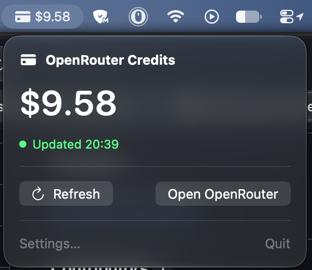

# OpenRouter Credits

A small macOS menu bar app that shows the remaining balance of your OpenRouter
account. It refreshes in the background and warns you when the balance drops
below a threshold you choose.



Written by [DeepSeek v4.1 Flash 1017](https://openrouter.ai/deepseek/deepseek-v4.1-flash-1017) using [Opencode](https://opencode.ai).

## Features

- Menu bar displays `creditcard.fill` and the current USD balance
- Popover with large balance, last-updated time, stale/error state, refresh,
  OpenRouter link, Settings and Quit
- Refreshes immediately at launch and after sleep/wake. While the balance is
  steady it polls slowly; a change switches it to a fast interval until the
  balance has been unchanged for a configurable number of checks.
- Low-balance notification once per downward threshold crossing, with an
  in-app orange warning as a fallback
- Optional launch at login
- Management key stored in the macOS Keychain only

## Requirements

- macOS 14 or later
- Xcode 16 or later (developed with Xcode 27)
- A free [OpenRouter](https://openrouter.ai) account
- An OpenRouter **management API key** from
  <https://openrouter.ai/settings/management-keys>

The management key is account-level admin access. Create it only for this app
and revoke it if the key is ever exposed.

## Build and run

The Xcode project is checked in; XcodeGen is not required.

```sh
make build    # build into .build/Build/Products/Debug
make release  # build into .build/Build/Products/Release
make test     # run the unit tests
make run      # build, sign, and launch
make icon     # regenerate the app icon PNGs
```

### Signing builds

`scripts/build.sh` uses the stable identity `OpenRouter Credits Local Signing`
when present, otherwise it falls back to ad-hoc signing. Override it with
`CODESIGN_IDENTITY`:

```sh
CODESIGN_IDENTITY="My Self Signed Cert" ./scripts/build.sh Release
CODESIGN_IDENTITY="My Self Signed Cert" make release
```

Running the Xcode scheme directly still uses ad-hoc signing.

## First run

1. Launch the app. A credit card item appears in the menu bar with `$--`.
2. Open the popover and choose **Settings…**.
3. Paste the management key and click **Test Connection**. You should see the
   remaining balance.
4. Click **Save**. The key goes into the Keychain and the menu bar updates.
5. Optionally set the low-balance threshold (default `$5`), tune the slow and
   fast refresh intervals, and enable **Launch at login**.

## How it works

- `CreditsStore` owns the balance, error, loading, last-updated and refresh state.
  It reads the Keychain once per launch and caches the key in memory.
- The background loop refreshes immediately, then uses the slow interval
  (default 5 minutes) while the balance is steady. A changed balance switches
  to the fast interval (default 1 minute). After a configurable number of
  consecutive unchanged checks (default 5) it returns to the slow interval.
  The intervals and check count are editable in Settings.
- Opening the popover refreshes only when the data is missing, stale, errored,
  or older than the current tier's interval.
- Wake from sleep triggers a refresh. Overlapping requests are ignored.
- Changing the low-balance threshold does not refresh or send a notification.
  The new value is used immediately for the in-app warning and for crossing
  detection on the next refresh.
- Retryable failures (HTTP 429, 5xx, network) use exponential backoff
  (60 s → 120 s → … → 900 s, capped) and honor `Retry-After`; auth and decoding
  errors wait for the normal interval. Data older than twice the slow interval
  is marked stale.
- A notification is sent only when the balance crosses from at/above the
  threshold to below it. Editing the threshold does not count as a crossing:
  it silently rebases the crossing state. The crossing state is persisted so
  relaunching the app while still below the threshold does not notify again.
  Exactly at the threshold is not “low”.
- Money is formatted as USD with two fraction digits, half-up rounding, and
  grouping (for example `$1,234,567.89`).

## Security and privacy

- The management key is stored as a generic password in the login Keychain
  (`kSecClassGenericPassword`, service `ai.openrouter.credits`, account
  `management-api-key`) with `kSecAttrAccessibleAfterFirstUnlock`.
- The key is read once per launch and kept in memory for the process lifetime.
  It is never written to UserDefaults, logs, crash reports, or URLs.
- No analytics or telemetry. The only network request is to
  `https://openrouter.ai/api/v1/credits`.
- Remove the key with:

  ```sh
  security delete-generic-password -s ai.openrouter.credits -a management-api-key
  ```

### Local build signing caveat

Create the `OpenRouter Credits Local Signing` certificate in Keychain Access
(**Certificate Assistant → Create a Certificate…**, Self Signed Root, Code
Signing) and trust it for Code Signing. A stable identity lets rebuilds keep
Keychain access; the ad-hoc fallback prompts again after each build.

After switching from ad-hoc signing, delete and re-enter the key once:

```sh
security delete-generic-password -s ai.openrouter.credits -a management-api-key
```

Self-signed builds are for local use only. Notifications may still be
unreliable; the in-app low-balance warning remains available.

## Tests

`make test` runs the XCTest target and covers:

- USD formatting: zero, grouping for large values, negative values, half-up
  rounding
- Credits JSON decoding: full response, missing optional totals, malformed body
- API error mapping: 401, 403, 429 with `Retry-After`, 5xx, offline/network,
  malformed JSON, Bearer header and endpoint
- Refresh behavior: no overlapping requests, stale-only popover refresh,
  slow/fast tier switching, returning to slow after unchanged checks, schedule
  clamping, retrying after an error, in-memory key caching
- Low-balance crossings: notify once, stay quiet while below, re-arm after
  rising, persisted state, custom threshold, threshold edits do not notify

### Manual QA checklist

- [ ] No key: settings explanation and `$--` menu bar, no crash
- [ ] Bad/expired key: readable error, balance not cleared to a wrong value
- [ ] Valid key: Test Connection and Save update the menu bar
- [ ] Background refresh and manual Refresh update the “Updated” time
- [ ] Sleep/wake triggers a refresh
- [ ] Offline: error shown, app retries with backoff
- [ ] Stale data (>2× slow interval): orange “stale” status
- [ ] Low-balance threshold raised above balance: orange warning, no
      notification from the threshold change itself, one notification per
      later crossing
- [ ] Launch at login on/off; error surfaced if registration fails
- [ ] Menu bar truncation with a large balance
- [ ] Multiple displays; settings opens in front
- [ ] Keychain prompt appears at most once per launch after the first approval

## Project layout

```text
OpenRouterCredits/
  OpenRouterCreditsApp.swift   MenuBarExtra + Settings scenes
  AppDelegate.swift            accessory policy, wake refresh, lifecycle
  Models/                      response/snapshot models, USD formatter
  Services/                    API client, Keychain, store, notifications,
                               backoff, launch at login, settings keys
  UI/                          menu bar label, popover, settings
  Resources/Assets.xcassets    app icon and accent color
  Info.plist                   LSUIElement = true
OpenRouterCredits.xcodeproj    checked-in project and shared scheme
OpenRouterCreditsTests/        XCTest target
scripts/                       build, test, run, icon generation
```

## Not in scope

- Multiple accounts or workspaces
- Usage history or charts
- Auto-update
- Always-on-top floating panel
